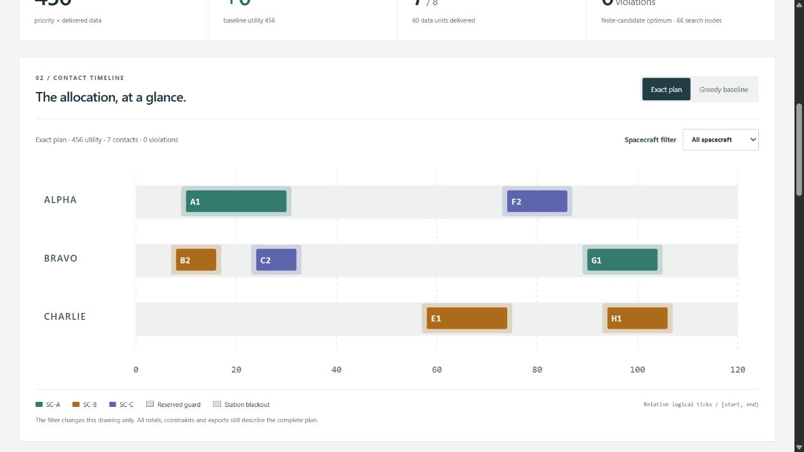

# Mission Contact Resource Scheduler

An offline contact-planning workbench by **Jason Stys**. Allocate fixed synthetic contact windows across a shared ground network, inspect the constraints, and compare an exact optimum with a greedy baseline.

The **single-station loss contingency** workflow now reoptimizes each full-window station outage, showing retained/removed/added contacts, before/after request assignments and service/energy changes. Every alternative preserves the current case's budgets and remaining constraints and uses the same exact objective. This is a contingency comparison, not a minimum-change or operational dispatch optimizer. See [the contingency guide](docs/CONTINGENCY.md).

[](https://github.com/JasonStys/mission-contact-resource-scheduler/actions/workflows/validate.yml)
[](https://github.com/JasonStys/mission-contact-resource-scheduler/actions/workflows/codeql.yml)



## What it demonstrates

- An original, deterministic branch-and-bound optimizer, with a complete finite search and explicit objective tie breakers.
- Competing station and spacecraft reservations, per-side guard time, maintenance/outage blocks, deadlines, band compatibility, full-delivery capacity, station-time budgets and spacecraft-energy budgets.
- An inspectable TypeScript interface: proportional station timeline, exact/greedy switch, spacecraft filter, decision inspector, resource ledger and every request's outcome.
- Eight synthetic scenarios, 432 reviewed parameter combinations, an independent exhaustive oracle and property-based generated-case tests.
- Reproducible SHA-256 evidence; full JSON, candidate CSV, inert HTML and editable input JSON; optional immutable local SQLite history.
- Strict local JSON imports through the CLI, loopback-only read-only HTTP, zero third-party Python runtime dependencies, and portable native desktop bundles.

**This is an educational allocation lab, not an operational scheduling product.** No live spacecraft, ground station, radio, orbital propagation, targeting, command, account or external data connection exists. Times are relative logical ticks; energy/data are invented units. “Optimal” means best among the supplied fixed candidates for the documented finite objective, not best across every possible real contact. No mission assurance, certification or endorsement is claimed.

## Try it

The [v1.1.0 release](https://github.com/JasonStys/mission-contact-resource-scheduler/releases/tag/v1.1.0) supplies Windows x64 ZIP and Linux x64/macOS ARM64 `.tar.gz` archives, each with a matching `.sha256` file. Verify the digest and extract the **whole archive**, preserving its `_internal` folder, licenses and POSIX links/permissions. Launch `MissionContactScheduler` (`.exe` on Windows). It starts a local service and opens your default browser. Keep its console open; Ctrl-C stops it. No installation, admin access, global Python or Node is needed for the bundled app.

Bundles are **unsigned**. Verify the checksum and trusted source; do not disable or bypass OS security warnings. Platform/architecture support is specific, not a promise to run on every device. See [user guide](docs/USER_GUIDE.md) and [release procedure](docs/RELEASE.md).

From source, use CPython 3.12–3.14 and Node 24:

```text
python -m venv .venv
# Windows: .venv\Scripts\activate
# Linux/macOS: source .venv/bin/activate
python -m pip install --require-hashes -r requirements-dev.lock
npm ci
npm run build
python -m scheduler serve
```

The development tools are not needed by the stdlib runtime. `serve --no-browser --port 8805` selects a fixed local port; otherwise an ephemeral port avoids conflicts. It never binds a public interface. GitHub contains source and downloads, **not a publicly hosted multi-user service**.

Start with **Greedy trap**, leave the defaults, and solve. The greedy baseline chooses one 100-utility contact; exact search chooses two compatible contacts totaling 120. Use the plan switch and inspect A1's obstacles. Try the all-stations-unavailable case: it produces a valid empty allocation, with all requests still visible.

## CLI and validation

```text
python -m scheduler export --scenario greedy-trap --output evidence.json
python -m scheduler export --format input --output case.json
python -m scheduler export --input case.json --guard 2 --policy 1 --output review.json --history local.sqlite3
python -m pytest --cov=scheduler --cov-report=term-missing
python -m ruff check scheduler tests tools launcher.py
python -m ruff format --check scheduler tests tools launcher.py
python -m mypy scheduler
python tools/benchmark.py
python tools/verify_repo.py
npm test
npm run build
npm run test:e2e
```

`test:e2e` requires the three Playwright browser engines (`npx playwright install chromium firefox webkit`; Linux may need `--with-deps`). CI runs the actual production handler and built assets, four OS/Python configurations, three browser engines, dependency audits, CodeQL and frozen-app smoke tests. See [validation evidence](docs/VALIDATION.md). Logs are kept by GitHub; these workflows upload no Actions artifacts or caches.

## Code and documentation map

| Area                                 | Responsibility                                                                                        |
| ------------------------------------ | ----------------------------------------------------------------------------------------------------- |
| `scheduler/model.py`                 | Strict immutable request/window schema and bounded duplicate-safe local JSON parser                   |
| `scheduler/solver.py`                | Constraint explanations, feasibility audit, greedy baseline, exact search and totals                  |
| `scheduler/engine.py`                | Finite controls, invented cases, complete evidence, canonical SHA and catalog                         |
| `scheduler/reports.py`               | JSON/CSV/HTML/input exports and explicit immutable SQL history                                        |
| `scheduler/server.py`, `__main__.py` | Protected loopback HTTP and source/bundled CLI                                                        |
| `scheduler/resources/history.sql`    | History schema and no-update/no-delete triggers                                                       |
| `web/`                               | Semantic HTML, responsive CSS, typed rendering contracts and UI controller                            |
| `tests/`                             | Independent exhaustive/property tests, malformed input, actual HTTP/SQL/CLI, browser acceptance       |
| `tools/`                             | Contract benchmark, exact-line indexes, verified portable packaging and gated draft releases          |
| `examples/nominal.json`              | Editable strict synthetic case                                                                        |
| `.github/workflows/`                 | Validation, CodeQL and manual three-platform release                                                  |
| `docs/`                              | Model, architecture, API, usage, security, release, third-party notices and actual validation reports |

Every file is summarized in [FILE_CATALOG](docs/FILE_CATALOG.md); [CODE_INDEX](docs/CODE_INDEX.md) supplies generated exact definition, argument and variable lines. File headers and function/class contracts describe responsibilities without duplicating brittle line numbers. CI rejects stale indexes and missing headers/docstrings.

Read [MODEL](docs/MODEL.md) for equations, assumptions, complexity and limitations; [ARCHITECTURE](docs/ARCHITECTURE.md) for design decisions; [API](docs/API.md) for exact contracts; [SECURITY](SECURITY.md) for trust boundaries.

## Author and contact

Designed and engineered by [Jason Stys](https://github.com/JasonStys). Portfolio: [jasonstys.github.io/portfolio-case-study-site](https://jasonstys.github.io/portfolio-case-study-site/). Questions and reproducible non-sensitive issues: [repository issues](https://github.com/JasonStys/mission-contact-resource-scheduler/issues). MIT licensed. Research references inform the concepts only; the optimizer and synthetic cases are original.

## Current portable release

Version 1.1.0 includes the current practical workflow in Windows ZIP and Linux/macOS tar.gz portable folders, with OS/CPU/version labels and source-bound release metadata. Historical 1.0.0 downloads predate these improvements. These are unsigned portable applications, not installers; preserve the entire extracted folder and POSIX links. See [release notes](docs/releases/v1.1.0.md), [local validation](docs/reports/PORTABLE_REFRESH_20261109.md) and [release procedure](docs/RELEASE.md) for exact acceptance and publication boundaries.

## Documentation editions

Start with the [organized handbook](docs/handbook.md) for current usage, design, security and test guidance. Reviewed downloadable editions: [project-guide.docx](docs/reports/project-guide.docx) · [validation-review.docx](docs/reports/validation-review.docx) · [validation-evidence.xlsx](docs/reports/validation-evidence.xlsx).

[Publication identities and source scope](docs/reports/publications.json) · [Documentation validation record](docs/reports/documentation-refresh-2026-11-09.md). Historical results retain their own tested revision and date.

## Illustrated Windows application guide

The [four-page Windows application guide](docs/reports/windows-application-guide.docx)
contains actual installed-application screenshots, a worked project scenario,
important source excerpts with exact line references, observed results and
operating limits. Read its [byte identities and review](docs/reports/windows-application-guide.json)
and the [dated installation validation](docs/reports/installed-windows-2026-11-10.md).
Prepared scenarios run inside the full application; there is no separate demo app.
